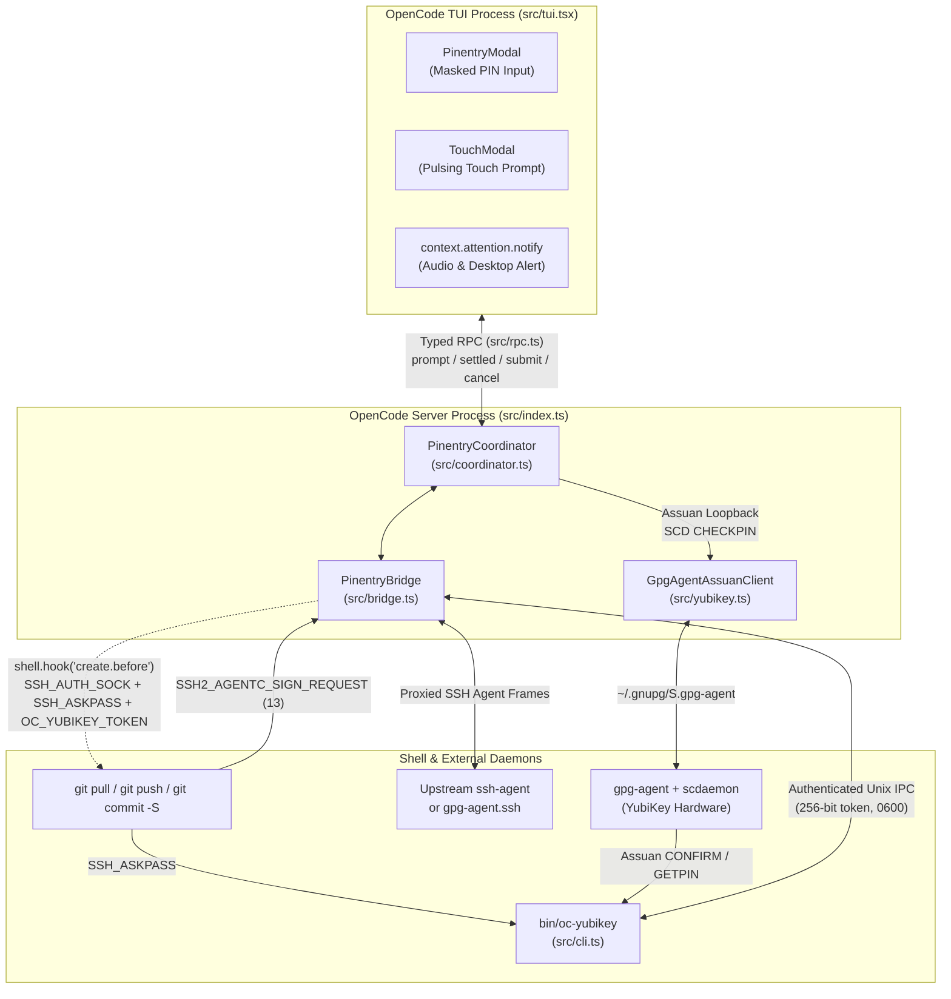
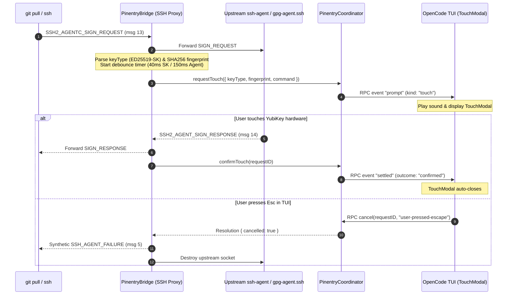
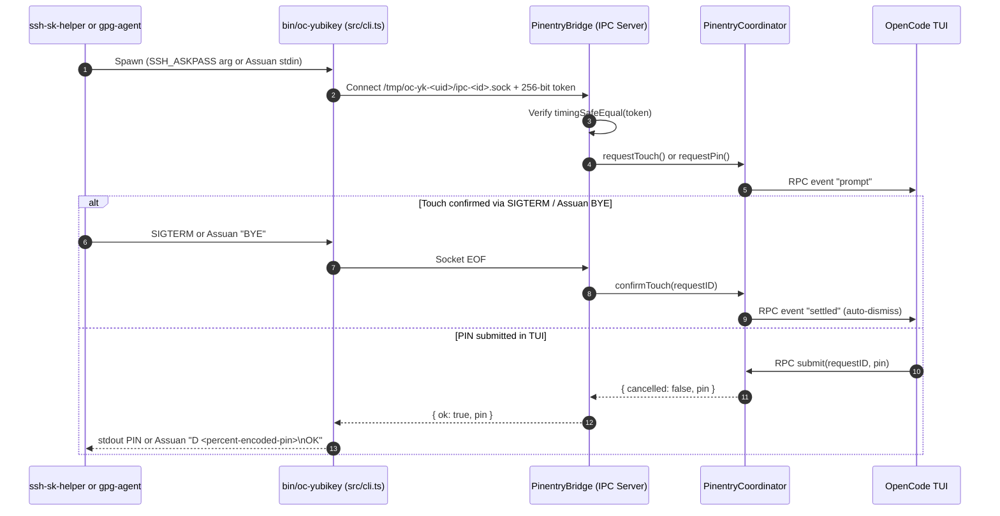
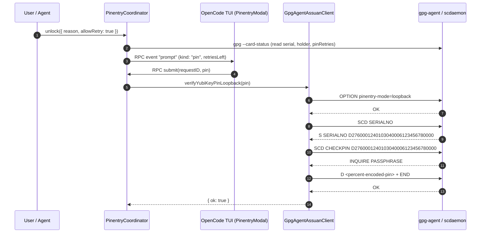
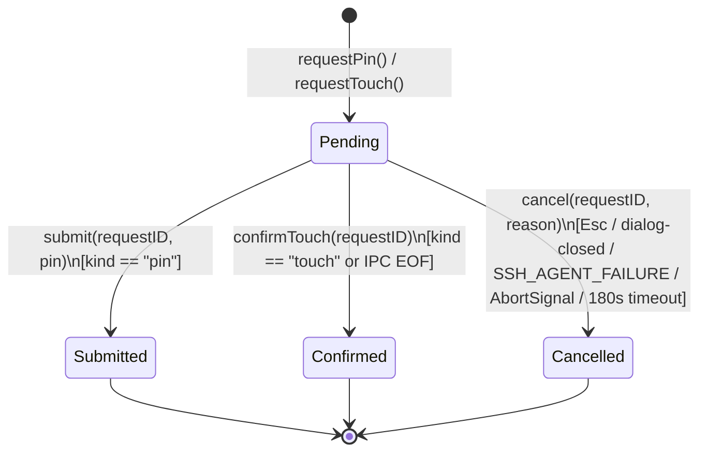

# `oc-yubikey` — YubiKey PIN & Touch Prompts for OpenCode V2

`oc-yubikey` is an OpenCode V2 plugin (`@opencode/plugin` + `@opencode/plugin/tui`) for macOS that brings native **YubiKey PIN entry** and **physical touch confirmation** into the OpenCode TUI—with audio notifications, automatic dismissal on hardware touch, and zero-exposure in-process Assuan PIN verification.

```bash
# Quick check inside any OpenCode session:
/yubikey status
```

---

## Table of Contents

- [Level 1 — Overview & Quick Start](#level-1--overview--quick-start)
- [Level 2 — Daily Usage](#level-2--daily-usage)
- [Level 3 — System Architecture](#level-3--system-architecture)
- [Level 4 — Security Model & Hardening](#level-4--security-model--hardening)
- [Level 5 — Configuration, Troubleshooting & Development](#level-5--configuration-troubleshooting--development)

---

## Level 1 — Overview & Quick Start

When an OpenCode agent or shell command runs `git pull`, `git push`, `ssh`, `git commit -S`, or `git tag -s` with a hardware-backed YubiKey (FIDO2 `sk-ssh-ed25519@openssh.com` / `sk-ecdsa-sha2-nistp256@openssh.com` or OpenPGP smartcard), the command normally blocks waiting for either a PIN or a physical touch on the YubiKey contact sensor. Without a TUI prompt, terminal sessions appear frozen or pop up external GUI windows behind the terminal.

`oc-yubikey` solves both problems directly inside OpenCode:

- **👆 Touch Your YubiKey Modal (`TouchModal`)**: Opens automatically with an audio chime when an SSH or OpenPGP operation awaits physical touch, displays the active command and key fingerprint, and **dismisses itself the instant you touch the YubiKey** (or aborts immediately if you press `Esc`).
- **🔑 YubiKey PIN Modal (`PinentryModal`)**: Masked PIN input with retry counter warnings, card serial/holder metadata, and in-process `gpg-agent` Assuan loopback verification (`SCD CHECKPIN`) so your PIN never touches disk, shell history, or model context.

### Quick Start (3 Steps)

1. **Register the plugin in `~/.config/opencode/opencode.jsonc`:**

   ```jsonc
   {
     "$schema": "https://opencode.ai/config.json",
     "plugins": ["github:yriveiro/oc-yubikey"]
   }
   ```

   A local checkout path (for example `"/path/to/oc-yubikey"`) also works during development.

2. **(Optional) Configure `~/.gnupg/gpg-agent.conf` for GnuPG touch & PIN fallback:**

   ```ini
   allow-loopback-pinentry
   allow-preset-passphrase
   pinentry-program /path/to/oc-yubikey/bin/oc-yubikey
   ```

   Reload `gpg-agent` after editing:

   ```bash
   gpg-connect-agent reloadagent /bye
   ```

3. **Verify inside OpenCode:**
   Run `/yubikey status` in the TUI prompt or ask the agent to run `yubikey_status`.

---

## Level 2 — Daily Usage

### Automatic Touch & PIN Triggers

Every shell command spawned by OpenCode passes through `oc-yubikey`'s `shell.hook("create.before")` hook, which attaches an authenticated IPC channel and transparent `SSH_AUTH_SOCK` proxy:

| Operation | Trigger | TUI Modal | Resolution |
| :--- | :--- | :--- | :--- |
| `git pull`, `git fetch`, `git push`, `ssh` (FIDO2 `-sk` or OpenPGP SSH key) | `SSH2_AGENTC_SIGN_REQUEST` or `SSH_ASKPASS` | `TouchModal` / `PinentryModal` | Auto-closes on physical YubiKey touch (`SIGN_RESPONSE` / `SIGTERM`) or aborts on `Esc` |
| `git commit -S`, `git tag -s`, `gpg --sign` | `gpg-agent` Assuan `CONFIRM` / `GETPIN` | `TouchModal` / `PinentryModal` | Auto-closes on physical touch or submits PIN over local IPC |
| `/yubikey unlock` or `yubikey_unlock` tool | Direct Assuan loopback (`SCD CHECKPIN`) | `PinentryModal` | Verifies and caches OpenPGP PIN in `gpg-agent` |

### TUI Slash Commands & Command Palette

| Command | Aliases | Description |
| :--- | :--- | :--- |
| `/yubikey` or `/yubikey unlock [reason]` | `/pinentry`, `/yk` | Open the PIN modal and unlock the YubiKey OpenPGP card in `gpg-agent` |
| `/yubikey touch [reason]` | `/yk touch` | Trigger a real FIDO2 hardware touch challenge (`ssh-keygen -Y sign`), play sound notification, and auto-dismiss on physical YubiKey touch |
| `/yubikey status` | `/yk info` | Show a toast with card serial, holder, signature counter, PIN retries, and UIF touch policy |
| `/yubikey lock` | `/yk reset` | Clear the cached PIN (`SCD RESET` + `RELOADAGENT`) |

### Modal Keyboard Shortcuts

| Key | `PinentryModal` Action | `TouchModal` Action |
| :--- | :--- | :--- |
| `Enter` | Submit PIN to `gpg-agent` / `SSH_ASKPASS` | — |
| `Tab` / `Ctrl+R` / `Alt+R` | Toggle masked (`••••••`) vs. visible PIN | — |
| `Ctrl+U` / `Ctrl+W` | Clear current PIN buffer | — |
| `Backspace` / `Delete` | Remove last character | — |
| `Esc` | Cancel PIN entry | Abort waiting SSH/GPG operation immediately (`SSH_AGENT_FAILURE`) |

### Agent Tools

All four tools are registered with `options: { codemode: false }` so the LLM must invoke them as explicit top-level tool calls:

- **`yubikey_status`**: Inspects `gpg-agent` readiness and `gpg --card-status` metadata (reader, serial, Application ID, holder, signature count, PIN retry counters `[user reset admin]`, and UIF touch policy).
- **`yubikey_unlock`**: Opens the TUI `PinentryModal` and verifies the user's PIN directly against `gpg-agent` (`OPTION pinentry-mode=loopback` → `SCD SERIALNO` → `SCD CHECKPIN <aid>`). The PIN is never returned to the LLM.
- **`yubikey_touch`**: Triggers a hardware FIDO2 user-presence challenge (`ssh-keygen -Y sign` against `~/.ssh/id_*_sk`), opens `TouchModal` in the TUI, and resolves automatically when the user physically touches the YubiKey.
- **`yubikey_lock`**: Clears cached PIN state in `scdaemon` and reloads `gpg-agent` (`SCD RESET` + `RELOADAGENT`).

---

## Level 3 — System Architecture

### Component Topology



### Flow 1: SSH Security Key & Hardware Agent Touch (`SSH_AUTH_SOCK` Proxy)



### Flow 2: `SSH_ASKPASS` & GnuPG Assuan `pinentry` Shim (`bin/oc-yubikey`)



### Flow 3: Direct Assuan Loopback Unlock (`yubikey_unlock`)



### Coordinator Request State Machine



---

## Level 4 — Security Model & Hardening

`oc-yubikey` enforces defense-in-depth across every IPC boundary, socket, and TUI surface:

| Control | Implementation |
| :--- | :--- |
| **Zero Model Exposure** | `yubikey_unlock` verifies the PIN inside the server process via Assuan loopback (`SCD CHECKPIN`) and returns only `{ ok, message, card }`. The raw `promptPin` RPC is disabled by default unless `allowRawPinRpc: true` is explicitly configured. |
| **Per-Instance 256-bit IPC Token Auth** | `PinentryBridge` generates a 32-byte cryptographic token (`randomBytes(32).toString("hex")`) per instance and verifies every IPC connection using `crypto.timingSafeEqual`. Unauthenticated local sockets are rejected before reaching `PinentryCoordinator`. |
| **Socket & Directory Ownership Verification** | `/tmp/oc-yk-<uid>` (`0700`), `ipc-<id>.sock` (`0600`), `active.json` (`0600`), and upstream `gpg-agent` / `SSH_AUTH_SOCK` paths are verified via `lstatSync` to reject symlinks, non-sockets, foreign UIDs, and group/world permissions (`mode & 0o077`). |
| **Atomic Pointer Updates** | `active.json` is written via an exclusive temporary file (`flag: "wx"`, `mode: 0o600`) and atomically renamed into place, then removed on `bridge.close()`. |
| **PIN Retry Lockout Guard** | `PinentryCoordinator.unlock()` checks the card's remaining user PIN retry counter before and after every attempt and refuses to automatically re-prompt when `pinRetries.user <= 1`, preventing accidental depletion of the final hardware attempt. |
| **Assuan & Display Sanitization** | Assuan commands reject `\r`, `\n`, and `\0`, validate `aid`/`keygrip` against `/^[0-9A-Fa-f]{16,64}$/`, zero temporary `Buffer` instances (`pinBuf.fill(0)`), and strip ANSI/OSC control characters and Unicode bidirectional overrides (`sanitizeDisplayText`) before rendering in the TUI. |
| **Trusted Executable Resolution** | Child processes (`gpg`, `gpgconf`, `gpg-connect-agent`, fallback `pinentry-mac`) are resolved against root/user-owned non-world-writable system directories (`/opt/homebrew/bin`, `/usr/local/MacGPG2/bin`, `/usr/local/bin`, `/usr/bin`, `/bin`) with recursion guards (`OC_YUBIKEY_FALLBACK_ACTIVE=1`). |
| **Bounded Buffers & Queues** | Enforces strict caps on IPC payloads (`64 KB`), SSH agent frames (`256 KB`), Assuan lines (`16 KB`–`64 KB`), child stdout/stderr (`256 KB`), and TUI PIN input (`128` characters). |

---

## Level 5 — Configuration, Troubleshooting & Development

### Plugin Options (`opencode.jsonc`)

```jsonc
{
  "$schema": "https://opencode.ai/config.json",
  "plugin": [
    [
      "/path/to/oc-yubikey",
      {
        // Optional explicit gpg-agent Assuan socket path:
        "agentSocketPath": "/Users/alice/.gnupg/S.gpg-agent",
        // Optional (default: false): allow raw promptPin RPC calls:
        "allowRawPinRpc": false
      }
    ]
  ]
}
```

### Environment Variables

| Variable | Role |
| :--- | :--- |
| `OC_GPG_AGENT_SOCK` | Overrides `gpgconf --list-dirs agent-socket` for Assuan connections |
| `OC_FALLBACK_PINENTRY` | Explicit path to a fallback GUI pinentry binary when running outside OpenCode |
| `OC_YUBIKEY_SOCK` | Injected automatically by `PinentryBridge.prepareShellEnv()` |
| `OC_YUBIKEY_TOKEN` | Per-instance 256-bit hex authentication token injected into shell subcommands |
| `OC_YUBIKEY_COMMAND` | Summarized shell command displayed in `TouchModal` / `PinentryModal` |

### macOS Apple `launchd` `ssh-agent` vs. Homebrew OpenSSH (`-sk` Keys)

macOS's built-in `/usr/bin/ssh-agent` (`com.apple.launchd.*/Listeners`) ships `/usr/libexec/ssh-sk-helper` compiled **without** `libfido2` (`internal security key support not enabled`). When an `sk-ssh-ed25519@openssh.com` or `sk-ecdsa-*` key is loaded into Apple's agent without `SSH_SK_PROVIDER`, signing via the agent fails and prevents Homebrew OpenSSH (`/opt/homebrew/bin/ssh`) from falling back to the local `~/.ssh/id_*_sk` file.

`PinentryBridge` automatically detects when it is proxying an Apple `launchd` `ssh-agent` socket without `SSH_SK_PROVIDER` and filters `sk-*` identities out of `SSH2_AGENT_IDENTITIES_ANSWER` (message `12`). Homebrew OpenSSH then uses the local `~/.ssh/id_*_sk` key with Homebrew's `ssh-sk-helper` and triggers `bin/oc-yubikey` via `SSH_ASKPASS=force`, displaying the OpenCode `TouchModal` and dismissing it as soon as you touch the YubiKey.

### Troubleshooting

- **`gpg-agent rejected loopback pinentry mode`**: Add `allow-loopback-pinentry` to `~/.gnupg/gpg-agent.conf` and run `gpg-connect-agent reloadagent /bye`.
- **Touch modal does not appear during `gpg --sign` outside OpenCode's shell**: Ensure `pinentry-program /path/to/oc-yubikey/bin/oc-yubikey` is set in `~/.gnupg/gpg-agent.conf` and reload `gpg-agent`.
- **YubiKey not detected (`connected: false`)**: Verify `gpg --card-status` succeeds in your terminal and that no other process holds an exclusive PC/SC lock on the smartcard reader.
- **TUI toast `Plugin failed: github:yriveiro/oc-yubikey`**: Refresh the installed copy from the `/plugins` dialog, or remove `~/.cache/opencode/npm/git-oc-yubikey-*` so OpenCode reinstalls it. Earlier revisions declared the OpenTUI peers optional, so `@opentui/solid` was never installed beside the plugin and the TUI entry failed to load with `Cannot find package '@opentui/solid'`; the peers are now required so the JSX runtime resolves from `node_modules`.

### Development & Verification

This repository uses **TypeScript 6.0+** with strict type-level invariants (`verbatimModuleSyntax`, `noImplicitOverride`, `allowImportingTsExtensions`, compile-time `Expect<Equal<...>>` checks) and runs natively on **Bun** and **Node 24+**.

```bash
# Type-check with TypeScript 6.0+
bun run typecheck

# Run unit, integration, and security tests
bun test
```
